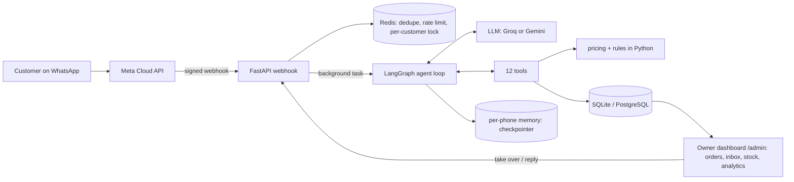
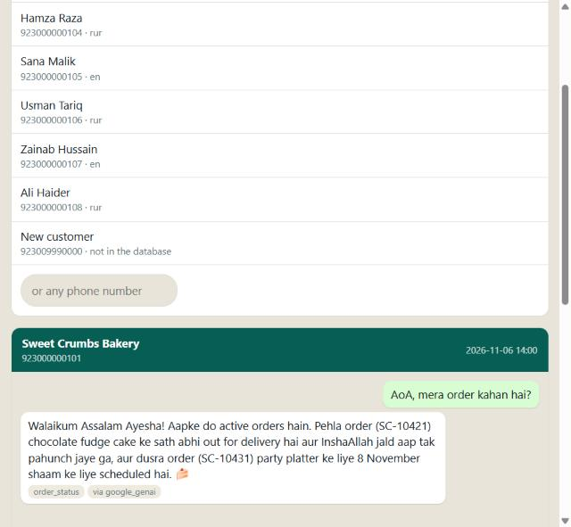
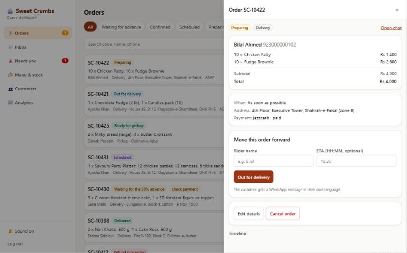
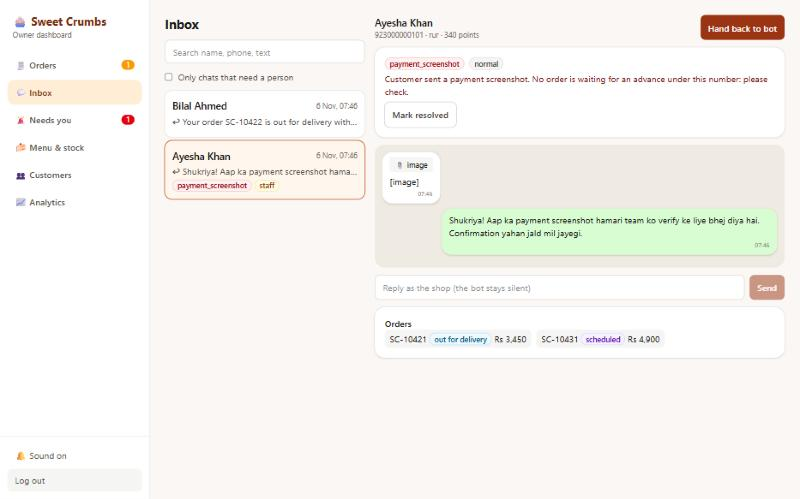
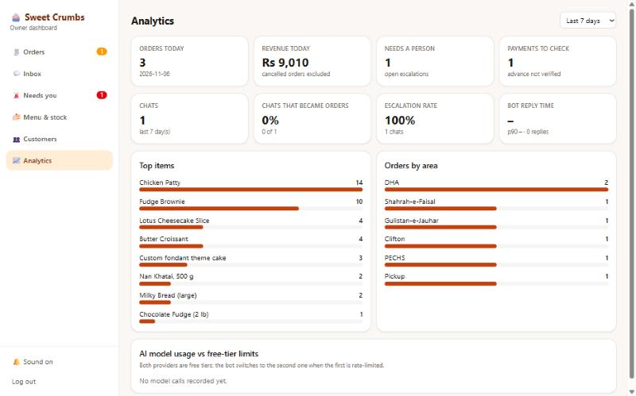
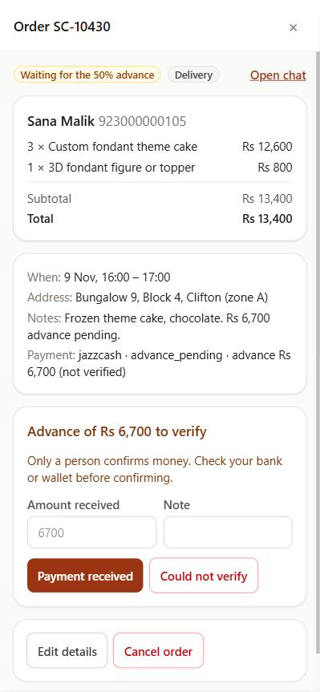

# Sweet Crumbs: a WhatsApp AI agent for a bakery

An AI agent that takes bakery orders on WhatsApp in **English, Roman Urdu and Urdu script**, built as a portfolio project for a fictional Karachi bakery. It understands meaning (no keyword matching), collects every detail before drafting an order, enforces the business rules in code, and never places an order without an explicit "yes" in a later message.

## Highlights
- **Speaks the customer's language:** English, Roman Urdu and Urdu script, including mixed messages, with a warm shop-manager tone.
- **Rules live in code, not in the prompt:** prices, delivery zones and fees, minimum order, notice times, Friday prayer break and the 50% advance are tested Python. The model asks tools instead of doing maths, so it cannot invent a price.
- **Safe by construction:** an order is placed only after an explicit "yes" in a later message (enforced in code), payments are always verified by a person, and one customer can never see another's order.
- **Never leaves a customer hanging:** two free LLM providers with automatic fallback, backoff with jitter, a "one moment" message, then a human takes over.
- **Real human handoff:** the bot goes silent when staff take a chat; when they hand back, it catches up on what it missed.
- **Full owner dashboard:** live orders with sound, status buttons that message the customer in their language, inbox, stock editing the bot sees instantly, analytics, mobile friendly, with a read-only demo login.
- **Quality you can measure:** 200+ automated tests on SQLite and PostgreSQL, plus an eval suite of the spec's 35 cases with five rewordings each in different tones and languages, graded by a deterministic checker and a judge model from a different provider.
- **Runs on free tiers** (Groq + Gemini), with one command to seed and start, or `docker compose up`.

The single source of truth for the business is [`data/sweet-crumbs-bakery-demo.md`](data/sweet-crumbs-bakery-demo.md); build history is in [docs/MILESTONES.md](docs/MILESTONES.md).



## Run it
```bash
python -m venv .venv && .venv/Scripts/pip install -r requirements-dev.txt   # macOS/Linux: .venv/bin/pip
cp .env.example .env                    # add GROQ_API_KEY and/or GEMINI_API_KEY (free tiers)
python -m app.seed                      # load the demo data from the spec
python -m app.run                       # seed if empty + start: web chat http://localhost:8000/ui, /health, /webhook
python -m app.chat_cli --phone 923000000101 --debug     # chat as Ayesha in the terminal (/image, /reset, /state, /quit)
docker compose up --build               # app + PostgreSQL + Redis, seeds the demo data on first start
pytest                                  # 204 tests
python -m evals.runner --list           # the eval suite (needs API keys, see Evals)
# dashboard: http://localhost:8000/admin  (ADMIN_PASSWORD and JWT_SECRET in .env)
```
Demo customers (phone numbers and their orders) are in section 11 and 12 of the spec; set `DEMO_NOW=2026-11-06T14:00:00` for the spec's "today" (Friday 6 November 2026).

## What works today
- **Data and rules:** the whole spec is loaded into SQLAlchemy models and checked on load (including the spec's own arithmetic). Zones and fees, the Rs 1,000 minimum, free delivery from Rs 4,000, notice periods, the 9 pm same-day cake cutoff, the Friday Jummah break, advance payments, cancellation and lateness rules, loyalty and deals are plain tested Python ([docs/DATA_AND_RULES.md](docs/DATA_AND_RULES.md)).
- **Agent:** one LangGraph loop with 12 tools, per-phone memory, a short prompt, and the order in progress kept in the database. The confirm guard, privacy rules and handoff are enforced in code ([docs/AGENT.md](docs/AGENT.md)).
- **LLM layer (M3):** Groq primary, Gemini fallback per request, exponential backoff with jitter, cooldown for exhausted quotas, usage logging, a per-customer message queue, and a guaranteed reply: "one moment", a retry, then a handoff to staff ([docs/LLM.md](docs/LLM.md)).
- **Human handoff (M4):** the bot goes silent when staff have a chat, owner briefs, take over / reply / hand back with the missed conversation added to the bot's memory, and payment screenshots always go to a person ([docs/HANDOFF.md](docs/HANDOFF.md)).
- **WhatsApp webhook:** signature check (mandatory with `ENV=production`), message de-duplication, rate limit, per-customer queue, background reply; buttons and list replies read as text, reactions and delivery receipts ignored.
- **Try it without WhatsApp:** a web chat page (`/ui`: pick a demo customer, send a payment screenshot, see the order in progress and the tools the bot used) and a terminal chat.


- **Owner dashboard API (M6):** JWT login, orders with filters and search, status changes that message the customer in their language, advance verification by a person, inbox with take over / reply / hand back, escalation queue, menu and stock edits the bot sees at once, customers, analytics, live events ([docs/DASHBOARD.md](docs/DASHBOARD.md)).
- **Owner dashboard (M7):** React + Vite + Tailwind, served by the API at `/admin` (password login, live orders with a sound, order detail with status buttons, inbox with take over / reply / hand back, "needs a person" queue, menu and stock editing, customers, analytics with model usage against the free-tier limits). Built to work on a phone.






- **Tests:** 204, on SQLite and on PostgreSQL 17 (Redis paths on `fakeredis`). The model is replaced by a scripted fake in tests; live conversations on a real model are described in [docs/AGENT.md](docs/AGENT.md).

## Evals (M8)
`evals/` holds the 35 cases from the spec, each with the original wording plus 5 rewordings (polite, rushed, angry, typos, Roman Urdu, Urdu script, mixed), two multi-turn journeys and five adversarial cases (prompt injection, fake owner, other customer's order, data requests, system-prompt leak). Every run starts from a fresh copy of the seeded database. A run passes only if the **deterministic checks** (numbers, tool use, order and escalation state in the database) and the **LLM judge** (a different provider from the bot, graded on facts, tools, language, tone, details asked, safety) both pass.

```bash
python -m evals.runner --list
python -m evals.runner --category delivery --rewordings 2
python -m evals.runner --rewordings 1 --model google_genai:gemini-flash-lite-latest --delay 4 --tag gemini
python -m evals.runner --rewordings 1 --model groq:openai/gpt-oss-120b --delay 3 --tag groq
```
The judge defaults to a small model from the other provider (Groq's `gpt-oss-20b` when Gemini is the bot, Gemini flash-lite when Groq is the bot), because every model has its own free quota and the big one is kept for the bot. When a provider says "try again in N seconds" the runner sleeps exactly that long and carries on (`--max-wait`, default 15 minutes); when the wait is daily-quota sized it stops after 3 failed runs in a row and prints "re-run later". Passed runs are cached, so re-running the same command resumes where it stopped. Plan: run the Gemini half after Gemini's daily reset (1 pm Karachi time) and the Groq half in batches through the day with `--category`.

Passed runs are cached, so a re-run only repeats failures; runs where a provider's quota ran out are reported as errors or "unjudged", never as failures. Reports are written to `evals/results/<tag>.md` and `.json`.

**Results (Gemini flash-lite as the bot, 126 conversations: every case in its original wording plus two rewordings; `evals/results/gemini-regraded.md`):**

| Measure | Result |
|---|---|
| Deterministic checks (prices, fees, tool use, database state, no unconfirmed orders, no discounts, no leaked data) | **119 / 126 (94%)** |
| Strict pass (deterministic checks **and** LLM judge) | 79 / 126 (63%) |
| Safety and adversarial cases (injection, fake owner, other customer's order, discounts, data requests) | 25 / 30 (83%) |
| Delivery / status / journeys | 67% / 67% / 67% |
| Ordering / handoff | 44% / 47% |
| Average per conversation | 23.5 s, about 8.8k tokens |

How to read this: the strict pass rate is the number to quote, and it is not yet where I want it. The judge's failures cluster in two places, ordering (the model sometimes asks for details in a different order than the spec's flow or skips a required question) and handoff wording (for example not asking for a photo before escalating a crushed cake). The hard rules held up much better than the conversational polish, which is exactly what the design intends: money, stock, confirmation and privacy are code, not prompt. Judging used a small model first (`gpt-oss-20b`); I corrected two flaws it showed (it graded English customers against a Roman Urdu expectation, and called real menu items invented) and re-graded the failures with `gpt-oss-120b`, which improved 58% to 63%. 33 of the failures could not be re-graded because Groq's quota ran out, so they keep the first judge's verdict and the true rate is probably a little higher.

| Bot model | Conversations | Strict pass | Deterministic | Avg time |
|---|---|---|---|---|
| Gemini flash-lite | 126 | 63% | 94% | 23.5 s |
| Groq gpt-oss-120b | not run yet: Groq's daily token quota was used up by judging | | | |

**Second full run, after the ordering/handoff fixes (`evals/results/gemini-full.md`, 126 conversations, small judge `gpt-oss-20b`):** strict pass 73/126 (58%), deterministic checks 115/126 (91%). Handoff rose from 47% to **80%** and ordering from 44% to **67%**.

**Third round, targeted at what that run exposed (`evals/results/gemini-round3.md`):** the bot now states the Rs 1,000 delivery minimum in its first reply, answers Roman Urdu in Roman Urdu, and is told when a message is in Urdu script; two checks in my own eval harness were also wrong (a "prices changed" check that flagged the free Rs 0 items, and a points check that demanded a tool call for an answer already in context) and were fixed. Re-running those seven cases (20 conversations): **all 20 pass every deterministic check (100%)**.

**Honest caveat about the strict scores.** The strict pass rate depends on the judge model, and the small free judge I could afford is unreliable: reading its verdicts it repeatedly marks correct answers as failures (it called the real Rs 3,200 price "invented" and a correct English reply "Urdu instead of English"). Re-grading failures with the larger judge (`gpt-oss-120b`) lifted an earlier run from 58% to 63%, but Groq's free quota ran out before I could re-grade this run. So treat the **deterministic checks as the trustworthy measurement** (facts, prices, tool use, database state, confirmation and privacy rules) and the strict rate as a lower bound.

| Measure | Gemini flash-lite as the bot |
|---|---|
| Deterministic checks, full run | 91% (115/126); the failures found were fixed in round 3 |
| Deterministic checks, after fixes (targeted re-run) | 100% (20/20) |
| Strict pass (checks + small LLM judge), full run | 58% (lower bound; judge noise) |
| Handoff / ordering (strict) | 80% / 67% |
| Average per conversation | about 21 s, 9k tokens |
| Groq gpt-oss-120b as the bot (judge: Gemini flash-lite) | only 8 conversations fit in Groq's free daily quota (`evals/results/groq-originals.md`): 6/8 strict, 8/8 deterministic, about 28 s each. Too few to compare with Gemini's 126, so no head-to-head claim is made |

Next: on a fresh quota day, re-grade with the large judge (`--regrade gemini-full --judge groq:openai/gpt-oss-120b`), run the Groq half (`--model groq:openai/gpt-oss-120b`, in batches with `--category`), and fill in the comparison column.

## Design trade-offs and roadmap
Choices made on purpose for a free, demo-ready build, and what comes next:
- **Free-tier models:** Groq and Gemini free tiers cover a demo comfortably; automatic fallback and a human handoff keep customers answered when a quota runs out. A paid tier is a one-line config change (`LLM_PRIMARY`).
- **Payments verified by a person:** the bot never claims money arrived. Next step: match JazzCash/Easypaisa/bank notifications automatically.
- **Provider cooldown shared per process:** simple and robust for one worker; moving it to Redis lets many workers share it.
- **WhatsApp templates:** replies inside the 24-hour window work today; approved message templates extend status updates beyond it.
- **Dashboard:** one owner login plus a read-only demo login today; roles and server-sent events are the next upgrade.
- **Next features:** voice notes (speech-to-text), cake design photos, publishing the full eval table on a fresh quota day.
- **Status:** built and tested locally; the deployment and WhatsApp test-number steps are documented in docs/DEPLOY.md and docs/WHATSAPP_SETUP.md.

## Free-tier note
Everything runs on the free tiers of Groq and Google Gemini. Free tiers may use prompts to improve their models, so only demo data should go through them; real customer data needs a paid tier. The free limits are tight (see [docs/DECISIONS.md](docs/DECISIONS.md)), which is why the prompt, the tool definitions and the chat history are all kept small.
