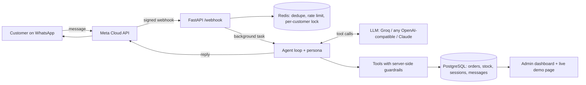

# Bilingual WhatsApp Business Agent

An agent for a small bakery ("Sweet Crumbs", demo data) that chats like a person on WhatsApp in **English, Roman Urdu and Urdu script**.
It checks stock, takes multi-item orders (pickup or delivery, cake notes), confirms before placing, tracks and cancels orders, and hands off to a human on complaints, refunds, health issues or anything unclear.



## Run
```bash
pip install -r requirements-dev.txt
cp .env.example .env                     # put GROQ_API_KEY=... (free key from console.groq.com)
uvicorn app.main:app --reload            # chat demo http://localhost:8000/demo   admin http://localhost:8000/
docker compose up --build                # same, with real Postgres + Redis
python -m evals.run_evals --brain llm    # 60-conversation eval on the LLM  (--brain rule = offline baseline)
python -m evals.converse                 # print full human-style transcripts
pytest                                   # evals (rule brain) + infrastructure tests
```
More: [docs/WHATSAPP_SETUP.md](docs/WHATSAPP_SETUP.md) (real number), [docs/DEPLOY.md](docs/DEPLOY.md) (hosting), [docs/DEMO_SCRIPT.md](docs/DEMO_SCRIPT.md) (video).

## Design
- **Tools** (`app/tools.py`): `get_product_details`, `check_stock`, `save_customer_info`, `propose_order`, `create_order`, `cancel_pending`, `get_payment_details`, `submit_payment`, `order_status`, `update_order`, `cancel_order`, `escalate`. Menu and shop facts live in `app/shop.py` ([docs/MENU.md](docs/MENU.md)); payment and order lifecycle in [docs/PAYMENTS.md](docs/PAYMENTS.md).
- **Guardrails are server-side**, so they hold for any model: an order can only be placed from a proposal made in an *earlier* customer turn; a size/flavour must be chosen; ready times respect lead times and opening hours; delivery addresses must be in a served area; **an order that needs payment is confirmed only by a human team member, never by the AI**; stock is deducted atomically (`UPDATE ... WHERE stock >= qty`, no overselling under concurrency); customers see and cancel only their own orders; quantities are capped.
- **Brains** (`app/agent.py`): `OpenAIBrain` (Groq, Gemini, OpenRouter, Ollama, anything OpenAI-compatible), `ClaudeBrain`, and a deterministic `RuleBrain` used offline and as the regression baseline. The persona ("Aisha") mirrors the customer's language, greets by time of day, remembers name and address.
- **Webhook** (`app/main.py`): verifies Meta's `X-Hub-Signature-256`, answers Meta immediately and replies from a background task, ignores redelivered message ids, rate-limits per customer, serialises messages per customer, replies politely to non-text messages, marks messages read.
- **Storage**: PostgreSQL when `DATABASE_URL` is set, SQLite otherwise (`app/db.py` adapter). **Redis** (`app/kv.py`) for dedupe, rate limits and locks, in-memory fallback when `REDIS_URL` is unset.

## Verified so far
| Check | Result |
|---|---|
| Offline rule baseline, 38 basic conversations (wording + DB effects) | 38/38 on SQLite and on PostgreSQL 17. Written and tuned by the same author: a regression suite, not an unbiased accuracy figure |
| Infrastructure + business-rule tests (26): webhook signature, dedupe, rate limit, no overselling when two buyers race, variation required, lead time and opening hours, delivery area, **advance rule, payment submit / team confirm / reject, screenshot via webhook, reservation expiry, cancel after payment, address/time change** | 26/26 on SQLite and on PostgreSQL 17 (Redis paths on `fakeredis`) |
| End-to-end payment flow in the browser demo (order 3 lb cake, receive details, send screenshot, team clicks Confirm, customer gets the confirmation) | worked, on the offline brain |
| LLM brain (`openai/gpt-oss-120b` on Groq), 28 rich conversations (birthday flow, ingredients, payment, changes, odd requests) | **not run since the payment update**: the Groq free tier's daily token limit (200k) was used up. Earlier runs on the previous prompt: DB outcome correct in 50/60 |

## Not done / not verified
- How the LLM handles the new payment, address and "other situations" prompts is **untested**; run `python -m evals.run_evals --brain llm` and `python -m evals.converse` once you have a model with enough quota (the prompt is about 4k tokens per call).
- No real WhatsApp number connected, not deployed; `docker compose` and `render.yaml` not run here.
- Payment account numbers, address, phone, prices and policies are fictional demo data (`app/shop.py`).
- Admin dashboard pages have no login (the status/payment API supports `ADMIN_TOKEN`). The image of a payment screenshot is not stored or read.
- No real shop is using it yet; demo video not recorded.
