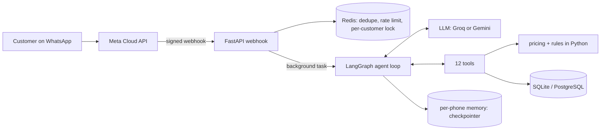

# Sweet Crumbs: a WhatsApp AI agent for a bakery

An AI agent that takes bakery orders on WhatsApp in **English, Roman Urdu and Urdu script**, built as a portfolio project for a fictional Karachi bakery. It understands meaning (no keyword matching), collects every detail before drafting an order, enforces the business rules in code, and never places an order without an explicit "yes" in a later message.

> **Rebuild in progress.** Milestones M0 to M2 are done; the owner dashboard, human-handoff silence, provider fallback and the eval suite follow. See [docs/MILESTONES.md](docs/MILESTONES.md). The single source of truth for the business is [`data/sweet-crumbs-bakery-demo.md`](data/sweet-crumbs-bakery-demo.md).



## Run it
```bash
python -m venv .venv && .venv/Scripts/pip install -r requirements-dev.txt   # macOS/Linux: .venv/bin/pip
cp .env.example .env                    # add GROQ_API_KEY and/or GEMINI_API_KEY (free tiers)
python -m app.seed                      # load the demo data from the spec
python -m app.chat_cli --phone 923000000101 --debug     # chat as Ayesha in the terminal (see tool calls)
uvicorn app.main:app --reload           # /health, /chat (dev), /webhook for WhatsApp
docker compose up --build               # app + PostgreSQL + Redis, seeds the demo data on first start
pytest                                  # 127 tests
```
Demo customers (phone numbers and their orders) are in section 11 and 12 of the spec; set `DEMO_NOW=2026-11-06T14:00:00` for the spec's "today" (Friday 6 November 2026).

## What works today
- **Data and rules:** the whole spec is loaded into SQLAlchemy models and checked on load (including the spec's own arithmetic). Zones and fees, the Rs 1,000 minimum, free delivery from Rs 4,000, notice periods, the 9 pm same-day cake cutoff, the Friday Jummah break, advance payments, cancellation and lateness rules, loyalty and deals are plain tested Python ([docs/DATA_AND_RULES.md](docs/DATA_AND_RULES.md)).
- **Agent:** one LangGraph loop with 12 tools, per-phone memory, a short prompt, and the order in progress kept in the database. The confirm guard, privacy rules and handoff are enforced in code ([docs/AGENT.md](docs/AGENT.md)).
- **WhatsApp webhook:** signature check, message de-duplication, rate limit, one message at a time per customer, background reply.
- **Tests:** 127, on SQLite and on PostgreSQL 17 (Redis paths on `fakeredis`). The model is replaced by a scripted fake in tests; live conversations on a real model are described in [docs/AGENT.md](docs/AGENT.md).

## Not built yet
Provider fallback and retry (M3), staff takeover and silence after escalation (M4), terminal and web chat polish (M5), owner dashboard (M6, M7), LLM-judged evals with rewordings (M8), final write-up (M9). No real WhatsApp number is connected, and nothing is deployed.

## Free-tier note
Everything runs on the free tiers of Groq and Google Gemini. Free tiers may use prompts to improve their models, so only demo data should go through them; real customer data needs a paid tier. The free limits are tight (see [docs/DECISIONS.md](docs/DECISIONS.md)), which is why the prompt, the tool definitions and the chat history are all kept small.
