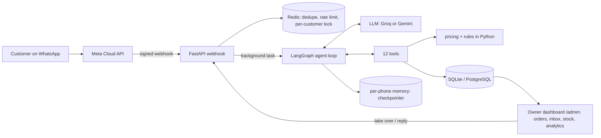

# Sweet Crumbs: a WhatsApp AI agent for a bakery

An AI agent that takes bakery orders on WhatsApp in **English, Roman Urdu and Urdu script**, built as a portfolio project for a fictional Karachi bakery. It understands meaning (no keyword matching), collects every detail before drafting an order, enforces the business rules in code, and never places an order without an explicit "yes" in a later message.

> **Rebuild in progress.** All milestones are built; the live eval run is still pending free-tier quota (see Evals). See [docs/MILESTONES.md](docs/MILESTONES.md). The single source of truth for the business is [`data/sweet-crumbs-bakery-demo.md`](data/sweet-crumbs-bakery-demo.md).



## Run it
```bash
python -m venv .venv && .venv/Scripts/pip install -r requirements-dev.txt   # macOS/Linux: .venv/bin/pip
cp .env.example .env                    # add GROQ_API_KEY and/or GEMINI_API_KEY (free tiers)
python -m app.seed                      # load the demo data from the spec
python -m app.run                       # seed if empty + start: web chat http://localhost:8000/ui, /health, /webhook
python -m app.chat_cli --phone 923000000101 --debug     # chat as Ayesha in the terminal (/image, /reset, /state, /quit)
docker compose up --build               # app + PostgreSQL + Redis, seeds the demo data on first start
pytest                                  # 204 tests
python -m evals.runner --list           # the eval suite (needs API keys, see Evals)
# dashboard: http://localhost:8000/admin  (ADMIN_PASSWORD and JWT_SECRET in .env)
```
Demo customers (phone numbers and their orders) are in section 11 and 12 of the spec; set `DEMO_NOW=2026-11-06T14:00:00` for the spec's "today" (Friday 6 November 2026).

## What works today
- **Data and rules:** the whole spec is loaded into SQLAlchemy models and checked on load (including the spec's own arithmetic). Zones and fees, the Rs 1,000 minimum, free delivery from Rs 4,000, notice periods, the 9 pm same-day cake cutoff, the Friday Jummah break, advance payments, cancellation and lateness rules, loyalty and deals are plain tested Python ([docs/DATA_AND_RULES.md](docs/DATA_AND_RULES.md)).
- **Agent:** one LangGraph loop with 12 tools, per-phone memory, a short prompt, and the order in progress kept in the database. The confirm guard, privacy rules and handoff are enforced in code ([docs/AGENT.md](docs/AGENT.md)).
- **LLM layer (M3):** Groq primary, Gemini fallback per request, exponential backoff with jitter, cooldown for exhausted quotas, usage logging, a per-customer message queue, and a guaranteed reply: "one moment", a retry, then a handoff to staff ([docs/LLM.md](docs/LLM.md)).
- **Human handoff (M4):** the bot goes silent when staff have a chat, owner briefs, take over / reply / hand back with the missed conversation added to the bot's memory, and payment screenshots always go to a person ([docs/HANDOFF.md](docs/HANDOFF.md)).
- **WhatsApp webhook:** signature check (mandatory with `ENV=production`), message de-duplication, rate limit, per-customer queue, background reply; buttons and list replies read as text, reactions and delivery receipts ignored.
- **Try it without WhatsApp:** a web chat page (`/ui`: pick a demo customer, send a payment screenshot, see the order in progress and the tools the bot used) and a terminal chat.


- **Owner dashboard API (M6):** JWT login, orders with filters and search, status changes that message the customer in their language, advance verification by a person, inbox with take over / reply / hand back, escalation queue, menu and stock edits the bot sees at once, customers, analytics, live events ([docs/DASHBOARD.md](docs/DASHBOARD.md)).
- **Owner dashboard (M7):** React + Vite + Tailwind, served by the API at `/admin` (password login, live orders with a sound, order detail with status buttons, inbox with take over / reply / hand back, "needs a person" queue, menu and stock editing, customers, analytics with model usage against the free-tier limits). Built to work on a phone.


- **Tests:** 204, on SQLite and on PostgreSQL 17 (Redis paths on `fakeredis`). The model is replaced by a scripted fake in tests; live conversations on a real model are described in [docs/AGENT.md](docs/AGENT.md).

## Evals (M8)
`evals/` holds the 35 cases from the spec, each with the original wording plus 5 rewordings (polite, rushed, angry, typos, Roman Urdu, Urdu script, mixed), two multi-turn journeys and five adversarial cases (prompt injection, fake owner, other customer's order, data requests, system-prompt leak). Every run starts from a fresh copy of the seeded database. A run passes only if the **deterministic checks** (numbers, tool use, order and escalation state in the database) and the **LLM judge** (a different provider from the bot, graded on facts, tools, language, tone, details asked, safety) both pass.

```bash
python -m evals.runner --list
python -m evals.runner --category delivery --rewordings 2
python -m evals.runner --rewordings 1 --model google_genai:gemini-flash-lite-latest --delay 4 --tag gemini
python -m evals.runner --rewordings 1 --model groq:openai/gpt-oss-120b --delay 3 --tag groq
```
The judge defaults to a small model from the other provider (Groq's `llama-3.1-8b-instant` when Gemini is the bot, Gemini flash-lite when Groq is the bot), because every model has its own free quota and the big one is kept for the bot. When a provider says "try again in N seconds" the runner sleeps exactly that long and carries on (`--max-wait`, default 15 minutes); when the wait is daily-quota sized it stops after 3 failed runs in a row and prints "re-run later". Passed runs are cached, so re-running the same command resumes where it stopped. Plan: run the Gemini half after Gemini's daily reset (1 pm Karachi time) and the Groq half in batches through the day with `--category`.

Passed runs are cached, so a re-run only repeats failures; runs where a provider's quota ran out are reported as errors or "unjudged", never as failures. Reports are written to `evals/results/<tag>.md` and `.json`.

**Results: not available yet.** On the day I ran them, both free tiers ran out of quota partway through (Groq's daily tokens, then Gemini's daily requests), so no complete pass rate exists and I will not invent one. Two live smoke cases passed on both providers (price lookup; manager request needed a language fix noted by the judge). The harness itself is covered by offline tests. **Partial run (Gemini flash-lite as the bot, Groq as the judge; `evals/results/gemini-flash-lite.*`):** 84 conversations were attempted. 25 were lost because Gemini's quota ran out, and in the other 59 the Groq judge was out of quota for most of them, so no judge verdict exists for them. The report's "passed 7/59" counts those missing verdicts as failures (that run used the first version of the runner, which I have since fixed to report them as "unjudged"), so ignore that number. What the run does show: **58 of the 59 conversations passed every deterministic check** (prices, delivery fees, tool use, no unconfirmed orders, no discounts, no leaked data). Those checks cover facts and state only, not tone or language, which is what the judge is for.

Fill in this table after running the two commands above on a fresh quota day:

| Bot model | Runs | Passed | Deterministic | Judge | Avg time |
|---|---|---|---|---|---|
| Gemini flash-lite | _pending_ | | | | |
| Groq gpt-oss-120b | _pending_ | | | | |

## What I'd improve next
- Run and publish the full eval table on a paid or fresh-quota day, and add the failing transcripts to the prompt/tool fixes.
- Provider cooldown is per process: move it to Redis so several workers share it.
- WhatsApp's 24-hour window limits staff replies and status messages outside it; use approved message templates.
- Payment verification is manual by design; integrate the JazzCash/Easypaisa/bank webhook to match amounts automatically.
- Proper dashboard users and roles instead of one password; server-sent events instead of polling.
- Voice notes (speech-to-text) and images of cake designs.

No real WhatsApp number is connected, and nothing is deployed.

## Free-tier note
Everything runs on the free tiers of Groq and Google Gemini. Free tiers may use prompts to improve their models, so only demo data should go through them; real customer data needs a paid tier. The free limits are tight (see [docs/DECISIONS.md](docs/DECISIONS.md)), which is why the prompt, the tool definitions and the chat history are all kept small.
