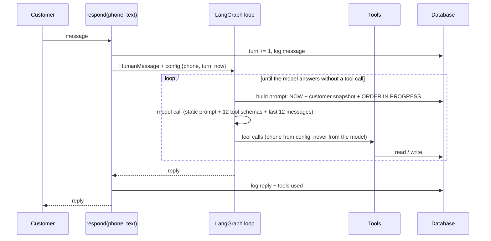

# The agent (M2)

## Tools (`app/tools.py`)
| Tool | What it does |
|---|---|
| `search_menu`, `check_stock` | menu with prices, flags and live stock; sold-out items come with in-stock alternatives (other sizes first, then similar items) |
| `check_delivery_area` | zone, fee and time; not served, or unclear ("Block 7": which area?) |
| `get_customer_profile` | name, points, saved addresses, active and recent orders (only for the chatting number) |
| `get_info(topic)` | business facts (hours, branches, delivery, payment, deals, policies, allergens, storage, loyalty); also searches by keyword, e.g. "halal" |
| `draft_order`, `update_draft` | collect and validate the order; return what is missing, what is wrong (with alternatives) and the exact totals |
| `confirm_order` | places the order; guarded (below) |
| `order_status`, `modify_order`, `cancel_order` | only the chatting customer's own orders; rules decide what is allowed |
| `escalate_to_human` | records reason, summary and the collected draft; one open escalation per customer |

The phone number, the turn counter and the clock come from the run config. The tool schemas do not contain a phone field, and any argument not in a schema is dropped before the tool runs.

## The confirm guard
A draft carries `version`, `summary_version` and `summary_turn`. `confirm_order` succeeds only if
1. the draft is valid and priced,
2. a summary of the **current** version was produced (`summary_version == version`), and
3. that summary was produced in an **earlier** customer turn (`summary_turn < current turn`).

So an order cannot be placed in the same message as its summary, a changed draft needs a new summary and a new yes, and an incomplete or invalid draft can never be confirmed. Custom/theme cakes, wedding and bulk orders report `needs_human` and are never placed by the bot.

## What the model sees (`app/agent.py`)
| Part | Size (measured) |
|---|---|
| static prompt (persona, tone, truth rules, order protocol, handoff, limits) | about 780 tokens |
| 12 tool definitions, compact schemas | about 1,500 tokens |
| dynamic block: date and time, customer, **order in progress** (rebuilt from the database every call) | about 100 to 300 tokens |
| history: last 12 messages; older tool results are cut to 140 characters and Gemini thinking signatures dropped | a few hundred tokens |

Live runs on Gemini lite used about **2,800 input tokens per model call and 2 to 3 calls per customer message**. Menu, policies and zones are not in the prompt; they come through tools.

## Live test on a real model (Gemini `gemini-flash-lite-latest`, demo clock Friday 14:00)
| Scenario (from the spec) | Result |
|---|---|
| Ayesha (Roman Urdu): birthday cake for ammi, 10-12 guests, message, candles, saved address, 7 pm, cash, yes | Asked one or two things at a time, offered her saved address, showed the summary, waited for "yes" in the next message and placed **SC-10432, Rs 3,450**, the spec's sample order |
| Bilal (English): sold-out 2 lb red velvet, Bahria Town, "where is my order", "cancel it" | Offered 1 lb and 3 lb from live stock, said Bahria Town is not served, gave the status of SC-10422, and escalated the cancellation because the kitchen had started |
| Zainab (mixed): "price of black forest and do you deliver to PECHS?", "2lb choc kal 7 bje", "is my bread ready?" | Answered both questions in one reply (Rs 200 PECHS fee), understood the shorthand, resolved "kal" to Saturday, reported SC-10425 ready for pickup at Gulshan |

### Problems the live runs exposed (all fixed and covered by tests)
- Tool results and thinking signatures from earlier turns were re-sent on every call (7,400 tokens per message): now shortened.
- The model sometimes scheduled "kal" for today, and sometimes set "no cake message" without asking: prompt rules added.
- A cancel request created two escalations (the tool escalates and the model also called `escalate_to_human`): one open escalation per customer.
- `get_info("halal")` returned the allergens page: keyword search over the topic text.
- `draft_order` and `update_draft` in the same step could overwrite each other: serialised per phone, merged within one message.
- An unrecognised place such as "Lahore" was treated like a bare block number: now "unknown" vs "unclear".

### Known limits at this stage
- Gemini's free tier allows 15 requests per minute on the lite model. Retries, fallback and the guaranteed reply are in place since M3 ([LLM.md](LLM.md)).
- Escalation records the handoff but the bot does not yet go silent (M4).
- Payment screenshots get a polite "text only" reply for now (M4 routes them to a human).
- The 35-case eval with rewordings and an LLM judge is M8; the live runs above are three hand-picked conversations, not a measured pass rate.
