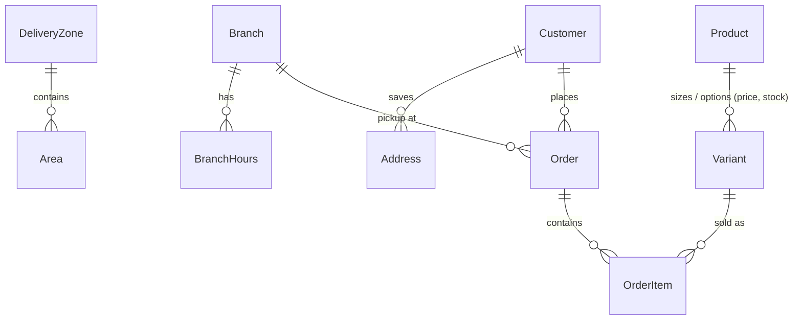

# Data model and business rules (M1)

All business data is loaded from [`data/sweet-crumbs-bakery-demo.md`](../data/sweet-crumbs-bakery-demo.md) by `python -m app.seed`.
Business rules live in `app/rules.py` as pure Python functions: **the LLM never computes a fee, a zone, a notice period or a refund**; later milestones expose these functions to it as tools.

Plus `Deal`, `Setting` (constants parsed from the spec), `InfoTopic` (facts for `get_info(topic)`), `StatusLabel` (English / Roman Urdu status wording).

## Seeded from the spec
3 branches with hours, 3 delivery zones and 38 areas (10 not served), 64 products with 80 variants (size/option, price, stock; `NULL` stock = unlimited or made to order), 5 deals with their schedules, 8 demo customers with saved addresses, 9 demo orders, 10 status labels, 13 info topics.

**The seed checks the spec as it loads it.** It stops with a `SeedError` if a constant's wording changes, a deal has no schedule rule, a customer's zone column disagrees with our area matching, or a demo order's items do not add up to the total the spec states (all 9 do).

## Rules (`app/rules.py`) and the spec cases they cover
| Function | Rule | Spec reference |
|---|---|---|
| `resolve_area` | longest alias wins (`DHA City` not served beats `DHA`), typo tolerant, bare `Block 7` is *unclear* and the bot must ask which area | section 3, tests 5, 6, 33, 34 |
| `delivery_fee`, `meets_minimum` | zone fee, free from Rs 4,000, minimum Rs 1,000 | tests 6, 7, 8 |
| `suggest_size` | serving guide, rounds up across the gaps (16-17 guests -> 3 lb); 4 lb is custom only; above 30 guests -> events team | section 5 |
| `eggless_surcharge`, `message_ok` | Rs 300 per lb; messages up to 30 characters | section 5 |
| `advance_required` | custom/fondant cakes and standard orders over Rs 15,000 need 50% advance | section 4, order SC-10430 |
| `human_routing_reasons` | over Rs 25,000, over 50 boxes, wedding/tiered, custom quote | sections 7, 9 |
| `is_open` | per-branch hours incl. after-midnight closing and the Friday 1:00-2:30 pm Jummah break | section 2 |
| `check_slot`, `ceil_to_slot` | past, 7-day horizon, same-day cakes before 9 pm, notice periods (eggless/sugar-free 24 h, custom 48 h, platters 6 h), 1-hour delivery slots 11 am-11 pm, Jummah slots | tests 16, 18, 30 |
| `asap_eta` | last order 10:30 pm, delivery from 10 am, nothing leaves during Jummah | test 30 |
| `cancellation`, `can_change`, `cake_message_editable` | free until preparation starts; custom cake advance refundable 24 h or more before delivery (always via a person); message editable until 2 h before | section 7, tests 10 |
| `is_late` | more than 30 minutes after the promised time | section 3, order SC-10385 |
| `points_earned`, `redeemable`, `birthday_discount` | 1 point per Rs 100; 100 points = Rs 500 off in whole blocks; 10% off one cake in the birthday month, no stacking (decision D6) | section 7, test 28 |
| `deal_active` | weekday, time window, channel, expiry | section 6 |

## Inventory (`app/inventory.py`)
Stock is per variant. `reserve` is a single conditional `UPDATE ... WHERE stock >= qty`, so two customers confirming at the same moment cannot both get the last cake (tested with a race, on SQLite and PostgreSQL). `reserve_many` is all-or-nothing for a whole order.

## Demo clock
`app/clock.py`: `DEMO_NOW=2026-11-06T14:00:00` fixes "today" (the spec's Friday 6 November 2026). The rule functions never read the clock themselves; callers pass `now`.

## Tests
`pytest tests` runs 63 tests. Set `TEST_DATABASE_URL=postgresql://...` to run them on PostgreSQL. The first-prototype tests (`test_infra.py`, `test_agent.py`) still run until M2 retires that code.
