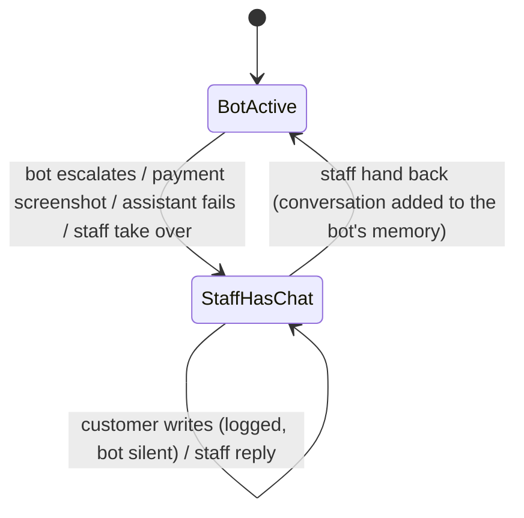

# Human handoff (M4)

## Rules (all in code, `app/handoff.py`)
- **One message, then silence.** When a chat is escalated the bot has sent its one "staff will reply" message; from then on `respond()` returns silently without calling the model. The customer's messages are still logged for staff.
- **Who escalates:** the model (`escalate_to_human`, for the cases in the spec), the system when the model is unavailable twice or crashes (`llm_unavailable`, `assistant_error`), a customer's payment screenshot (`payment_screenshot`), the cancel tool when the kitchen already started, and staff taking over. One open escalation per customer; later reasons are added to it.
- **Payment screenshots (images and documents)** are handled without the LLM: they create a *high priority* escalation when an advance is waiting (with the order code and amount in the summary), normal priority otherwise, and the customer gets one fixed message in their language saying staff will verify it. The bot never says money was received or confirmed.
- **Voice notes, stickers, videos** get a polite "text only" reply and no escalation.
- **Brief for the owner** (`escalation_brief`): reason, priority, order code, summary, the collected draft rebuilt and priced (items, address, time, payment, total, what is still missing) and the last six messages, so the customer is not asked again.
- **Take over / reply / hand back:** taking over silences the bot (and opens an escalation if there is none); staff replies are logged as `human` messages and sent over WhatsApp; handing back resolves the open escalations, turns the bot on, and adds everything said meanwhile (customer messages and staff replies) to the bot's memory so it continues from where the conversation really is.
- WhatsApp only allows free-form replies within 24 hours of the customer's last message; a staff reply after that needs an approved template (not built).

Tests: `tests/test_handoff.py`, `tests/test_recovery.py`.
