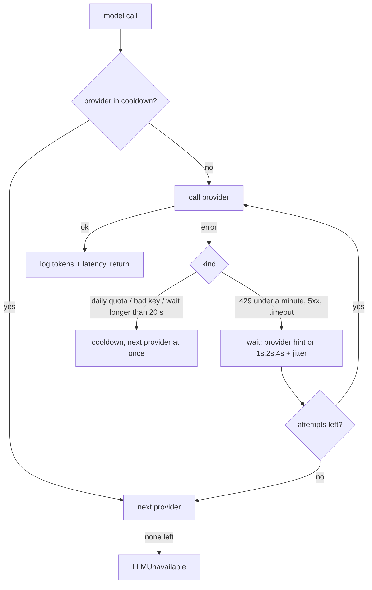

# The LLM layer (M3)

Everything runs on free tiers: **Groq** primary, **Google Gemini** fallback, both set in `.env`:
```
LLM_PRIMARY=groq:openai/gpt-oss-120b
LLM_FALLBACK=google_genai:gemini-flash-lite-latest
```
A provider without an API key is skipped. Models are never hard-coded (Google retires model names often).

## How a request is served (`app/llm.py`)

- **Error classification** reads real provider messages: Groq "try again in 21m2.3s" (daily token limit), Gemini "retry in 7h28m44s" (daily requests), "high demand" 503s, timeouts, bad keys.
- **Backoff:** exponential (1 s, 2 s, 4 s, capped at 20 s) plus jitter, or the provider's own hint if it is longer.
- **Cooldown:** a provider whose daily quota is gone is skipped for as long as it asked, so later customers do not wait for it. (Held in process memory: with several app instances each learns on its own.)
- **Fallback per request:** the next provider answers that request. Which provider answered is stored on each reply, and every call (also failed ones) is a row in `llm_usage`: provider, model, tokens, latency, error kind, `fallback_from`.
- **Usage vs the free-tier limits** is computed by `app/usage.py` for the dashboard (Groq 8,000 tokens/min, 200,000 tokens/day, 1,000 requests/day; Gemini lite 15 requests/min).

### Tool calls across providers
A request can move from one provider to the other **in the middle of a conversation**. Tool calls cannot be replayed between providers: Gemini 3 rejects function calls that lack *its own* thought signature (`400 INVALID_ARGUMENT: Function call is missing a thought_signature`), and ids and content formats differ. So before a call, every tool exchange written by *another* provider is replaced by one plain-text note of what was looked up ("[Already looked up for this request] check_delivery_area({...}) -> {...}"). A provider's own tool calls are kept as they are, and Gemini's list-of-blocks content is flattened to text for Groq. This was found by a live run (not by the scripted tests) and is covered by tests.

## When both providers fail (`app/agent.py: respond`)
1. The customer gets a short "one moment please" (in their usual language), sent through `notify`.
2. After a pause (`LLM_RETRY_DELAY`, 20 s, or the provider's hint up to 60 s) the request is retried **from its checkpoint**, so the customer's message is not added to the conversation twice.
3. If that fails too: a polite message, then an escalation (`llm_unavailable`, high priority) with the customer's message and anything collected, and the bot goes silent until staff hand the chat back.
A crash (a bug or a tool exception that escapes) skips the retry: polite message and escalation (`assistant_error`).

## Per-customer queue (`app/inbound.py`)
Incoming WhatsApp messages go into a per-customer queue (Redis, or memory for one process). One worker per customer drains it under a lock: messages that arrive while an answer is being produced wait, then are answered **together as one request** (one model call, in order, never two in parallel for the same customer). Different customers do not wait for each other. Each raw message is logged individually for the dashboard inbox.

## Live check
A real conversation (Groq primary, over its daily quota; Gemini fallback): the first call went to Groq, its second call hit the limit, Gemini continued the same request using the text note of what Groq had looked up, and all later messages stayed on Gemini with no wasted Groq attempts. Rows in `llm_usage` show provider, tokens, the error and `fallback_from=groq`.

## Tests
`tests/test_llm.py` (classification of real error messages, backoff arithmetic, hint waits, fallback, cooldown and recovery, both-fail, cross-provider tool traffic, usage summary), `tests/test_recovery.py` (one moment, resume, give up, crash, silence after escalation), `tests/test_inbound.py` (ordering, coalescing, no parallel calls, silent replies; memory and Redis).
